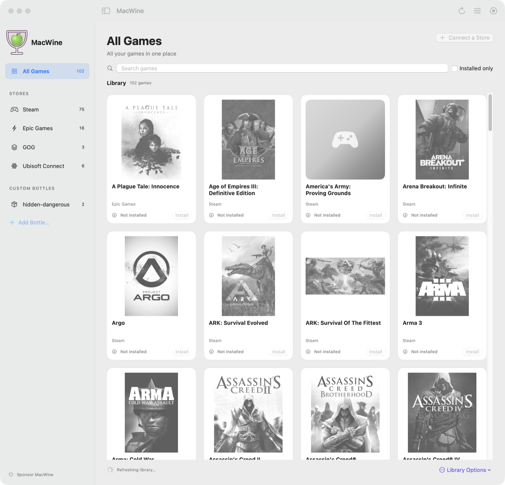
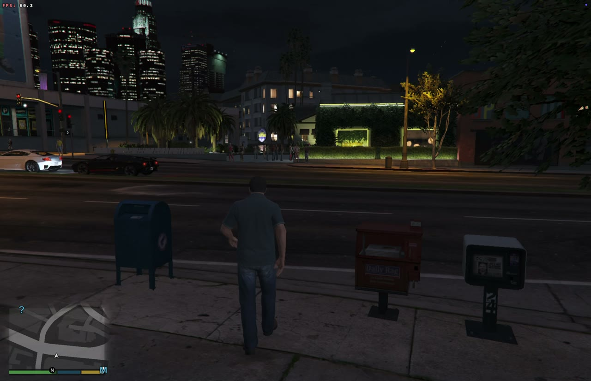
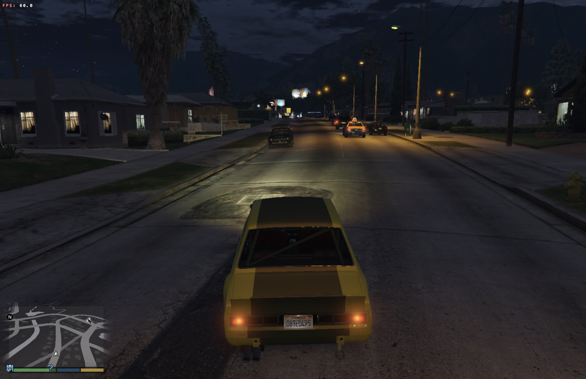
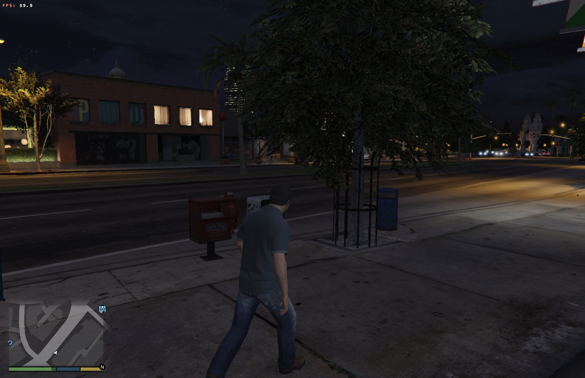
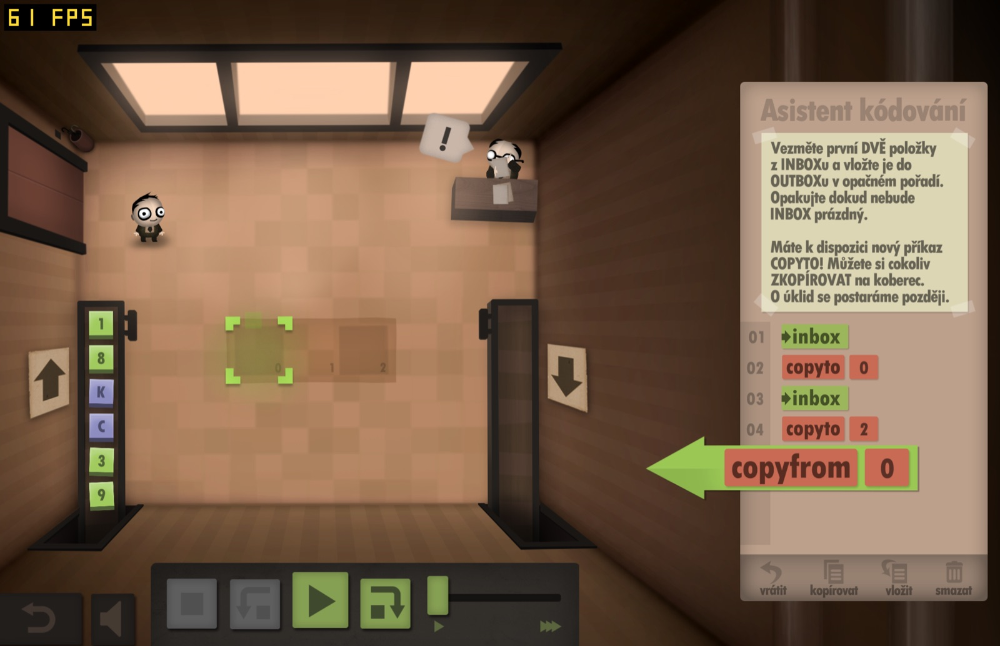
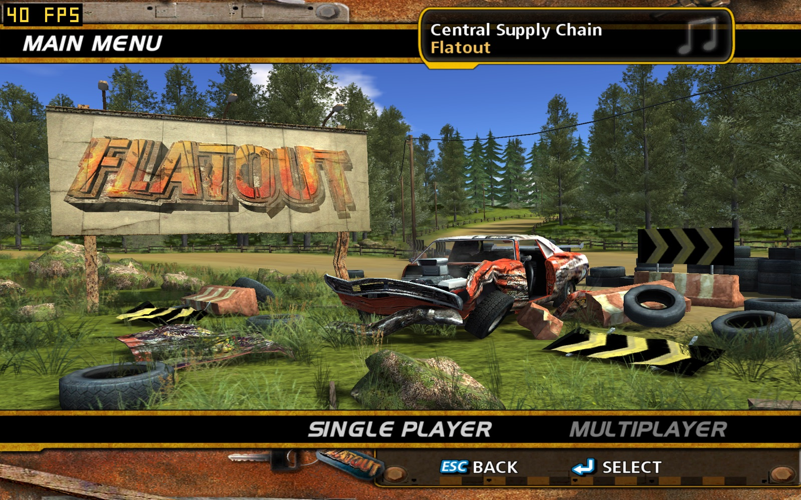
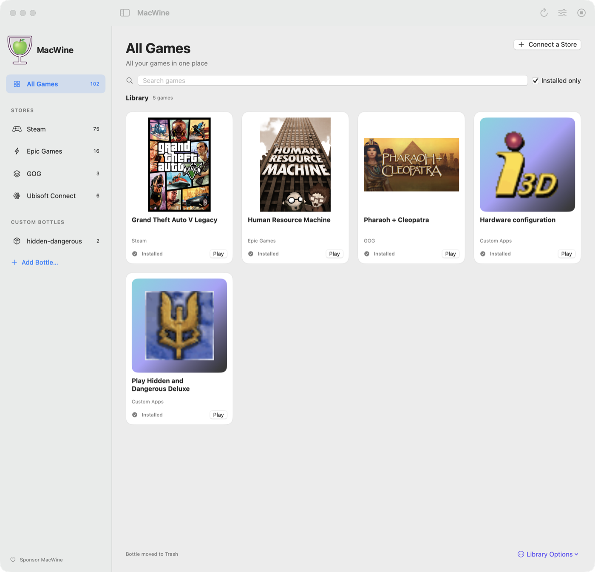
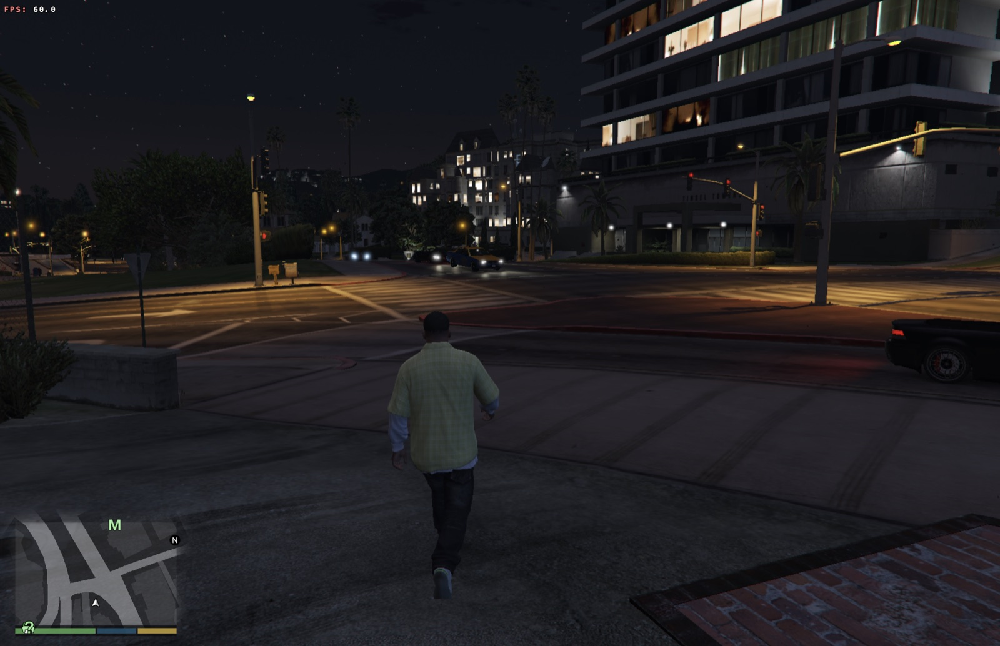

# MacWine

Run Windows games and apps on Apple Silicon Macs — with your Steam, Epic Games, GOG and Ubisoft libraries in one place.

MacWine is a free, open-source macOS app built on [Wine](https://www.winehq.org), [DXVK](https://github.com/doitsujin/dxvk) and [MoltenVK](https://github.com/KhronosGroup/MoltenVK). DirectX 9–11 games are translated to Vulkan and then to Metal; the Windows part runs under Rosetta 2.

> **Status: early preview.** Many games work, many do not. Check the community ratings in the app before you install a large game.



## Screenshots

[](docs/screenshots/gta-v.mp4)

*GTA V Legacy on a MacBook Pro M1 Pro at 60 FPS (Steam, DirectX 11 through DXVK). Click the image for the 30-second video.*

| | |
| --- | --- |
|  |  |
|  |  |
| *Human Resource Machine (Epic Games)* | *FlatOut (GOG, DirectX 9)* |
|  |  |

## Features

- **Your store libraries in one app.** Sign in once and MacWine shows every game you own; games that are not installed yet are shown in gray.
  - **Steam** – full library; games install and run through the Steam client.
  - **Epic Games** – sign in inside MacWine; games download directly (no Epic launcher), via [Legendary](https://github.com/legendary-gl/legendary).
  - **GOG** – sign in inside MacWine; DRM-free games download directly (no GOG Galaxy), via [gogdl](https://github.com/Heroic-Games-Launcher/heroic-gogdl).
  - **Ubisoft Connect** – sign in once in Ubisoft Connect; MacWine then shows your library. Ubisoft games download and start through Ubisoft Connect.
- **One Windows environment ("bottle") per store**, created automatically, plus your own bottles for any `.exe` or `.msi`. Double-click Windows installers in Finder to open them in MacWine.
- **Game shortcuts** as Mac apps (Dock, Launchpad, Desktop), with the game's icon or your own image.
- **Community compatibility ratings** (0–5 stars) shared by all MacWine users through GitHub Discussions.
- **Windows components** (Visual C++, .NET, DirectX libraries, fonts…) installable per bottle.
- **Per-game options:** FPS counter, *Better sound for older games* (DSOAL – fixes metallic or choppy DirectSound audio), open the game's folder.
- **Performance settings** per bottle: FPS limit (also for DirectX 9 games), performance HUD, graphics backend.
- **Automatic updates** (Sparkle).

MacWine never asks for your store passwords: you sign in on the store's own web page or in its own launcher. Sign-in tokens stay on your Mac.

## Requirements

- A Mac with Apple Silicon (M1 or newer)
- macOS 13 Ventura or newer, Rosetta 2
- Enough disk space for your games

## Install

Download the latest `MacWine.zip` from [Releases](../../releases), unzip it and move **MacWine.app** to *Applications*. On first launch MacWine downloads its Windows runtime (about 90 MB).

MacWine is not notarized by Apple yet, so macOS blocks the first launch. Open it once, then go to *System Settings → Privacy & Security* and click **Open Anyway** (on macOS 13–14 you can also right-click the app and choose **Open**).

## Tested games

See [COMPATIBILITY.md](COMPATIBILITY.md) for what has been tested by hand, and the community ratings in the app for everything else.

## Tips

- **GTA V (Legacy):** use *Windowed Borderless* instead of exclusive fullscreen and a 60 FPS limit. Story mode works; online modes that need BattlEye are not supported.
- **Games that do not start:** try *Windows components* (Visual C++ 2015–2022 first) and check the community ratings and reports for the game.
- **DirectX 12** games need Apple's D3DMetal from the Game Porting Toolkit, which MacWine cannot redistribute. You can import your own copy (`macwine d3dmetal import <toolkit .dmg>`); support is experimental.
- **Anti-cheat** (BattlEye, Easy Anti-Cheat, Vanguard…) usually blocks Wine. Those games will not run.

## Rate a game

Open a game in MacWine → **Rate This Game…** → pick 0–5 stars → **Continue on GitHub**. The report is pre-filled; add a note and post it. Ratings are collected every hour and appear in the app for everyone. A free GitHub account is needed to post; reading ratings needs nothing.

| Stars | Meaning |
| --- | --- |
| 0 | Does not start |
| 1 | Starts, but is not playable |
| 2 | Playable with major problems |
| 3 | Playable with some problems |
| 4 | Works well, minor issues |
| 5 | Works perfectly |

## Command line

The app is a front end for the `macwine` command line tool (inside the app: `MacWine.app/Contents/Resources/macwine`).

```bash
macwine create mygames                       # new bottle
macwine run mygames "/path/to/setup.exe"     # run a program
macwine connect gog                          # connect a store (creates the "gog" bottle)
macwine library epic --json                  # owned + installed games
macwine install gog gog 1207658693           # install a game
macwine set mygames fps 60                   # FPS limit (0 = off)
macwine components install mygames vcrun2022
macwine kill mygames                         # stop everything in a bottle
```

Run `macwine` without arguments for the full list. Useful environment variables:

| Variable | Meaning |
| --- | --- |
| `MACWINE_LOG=1` | Wine and DXVK logs in `~/MacWine/logs/<bottle>-<time>/` |
| `MACWINE_HUD=1` | DXVK HUD (FPS, frame times, GPU load) |
| `MACWINE_FPS=<n>` | One-off FPS limit |
| `MACWINE_HOME` | Data folder (default `~/MacWine`: bottles, accounts, logs) |

## Building from source

Requirements: Apple Silicon, full Xcode, Homebrew in `/opt/homebrew` with CMake, Ninja, Meson, pkg-config, autoconf/automake/libtool, Bison, Flex, LLVM/LLD, GMP, MPFR, MPC and ISL.

```bash
export MACWINE_BUILD="$HOME/macwine-build"
./prepare-sources.sh "$MACWINE_BUILD"   # downloads the Wine source archive, verifies it, applies patches/
./build-toolchain.sh                   # binutils 2.41, GCC 13.4, mingw-w64 11 (x86_64 + i686)
./build-deps.sh                        # FreeType, GMP, Nettle, GnuTLS (x86_64)
./build-moltenvk.sh                    # MoltenVK with MacWine's defaults
./build-wine.sh                        # Wine (x86_64, WoW64) + native build tools
./build-dxvk.sh                        # DXVK, 32 and 64 bit
tools/build-tools.sh                   # small native helpers (icons, store caches)
./package-runtime.sh                   # bundles libraries, fixes load paths, signs locally
./package-app.sh --install             # builds MacWine.app into ~/Applications
```

Each script keeps its state in `$MACWINE_BUILD/obj`; use a fresh build folder for a clean build. Wine is built from the Wine source archive published by CodeWeavers (see `prepare-sources.sh`), with MacWine's patches applied:

- `wine-macwine-compat.patch` – per-program compatibility rules read from `HKCU\Software\MacWine\Compat` (extra arguments for Chromium-based launchers such as Steam, Rockstar and Ubisoft Connect, and similar fixes).
- `wine-macwine-username.patch` – the Windows user is always called `macwine`, so bottles can move between Macs.
- `wine-macwine-wined3d.patch` – FPS limit and an optional FPS counter for games that use Wine's own Direct3D (DirectX 9 and older).
- `moltenvk-defaults.patch` – MoltenVK defaults tuned for games under Wine.
- `moltenvk-spirv-cross-alias-sampler.patch` – SPIRV-Cross fix for aliased combined image-samplers (DXVK Direct3D 9 shaders).
- `dxvk-mingw14.patch` – builds DXVK with the mingw-w64 toolchain above.

Releases: `MACWINE_RELEASE_REPO=<owner>/<repo> ./release.sh <version>` builds the app, the runtime archive and a signed Sparkle appcast.

## Project layout

| Path | Contents |
| --- | --- |
| `macwine` | Command line tool (bottles, stores, games, settings) |
| `app/` | SwiftUI app |
| `build-*.sh`, `prepare-sources.sh` | Runtime build |
| `package-*.sh`, `release.sh` | Packaging, releases, updates |
| `patches/` | Patches for Wine, DXVK and MoltenVK |
| `tools/` | Native helpers: `.exe` icons, Steam/Ubisoft cache readers, app icon |
| `.github/` | Ratings aggregation, sponsorship |

## Support the project

If MacWine is useful to you, you can [sponsor its development on GitHub](https://github.com/sponsors/mnavratil92-afk).

## License

MacWine's own code is licensed under the **GNU LGPL 2.1** (see [LICENSE](LICENSE)). Wine, DXVK, MoltenVK and the other components keep their own licenses — see [NOTICE](NOTICE).

MacWine is not affiliated with Apple, CodeWeavers, Valve, Epic Games, GOG or Ubisoft. All trademarks belong to their owners.
